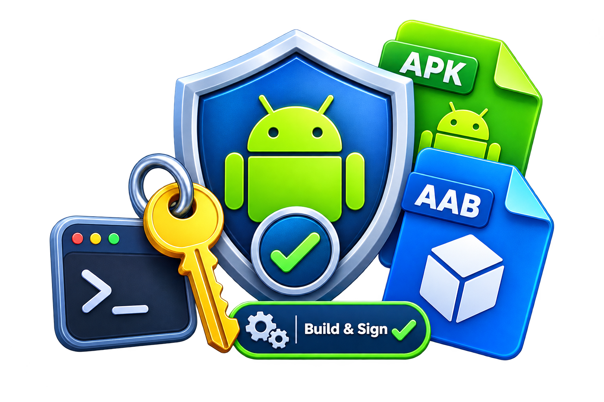

<p align="center">
  
</p>

<h1 align="center">Signing Script</h1>

<p align="center">
  Created by <a href="https://github.com/ZayedCom">Zaid K. Al Qassar</a> · <a href="https://github.com/ZayedCom">ZayedCom</a>
</p>

Windows helper that builds **signed release APK and AAB** files from an Android Studio project. It does not ship a keystore or passwords. You add each app once; after that you pick it by **app name** and the script restores the project path, keystore, and passwords.

## What it does

1. Lets you pick a saved app (or add a new Android Studio project folder).
2. Reads `settings.gradle` / `settings.gradle.kts` and finds application modules (phone, Wear OS, TV, sync, and so on).
3. Asks for your keystore file, store password, key alias, and key password.
4. Optionally bumps `versionCode` and `versionName` in each selected module.
5. Runs Gradle `assembleRelease` and `bundleRelease` with signing injected at build time (your app Gradle files do not need hardcoded secrets).
6. Copies the signed APK and AAB into an output folder, renamed with the app name and version.

Nothing in this repository is app-specific. Point it at any Android Studio project.

## Requirements

- Windows
- PowerShell (Windows PowerShell 5.1 or PowerShell 7)
- An Android Studio project with `gradlew.bat` (or `gradlew`) and `settings.gradle` / `settings.gradle.kts`
- JDK `keytool` on `PATH` (comes with Android Studio’s JBR / a JDK install) — used to verify the keystore before building
- A release keystore (`.jks`, `.p12`, or `.keystore`) that you keep **outside** this repo

## Quick start

1. Clone or copy this folder.
2. Double-click `signing-script.bat`  
   or from a terminal:

   ```bat
   powershell -NoProfile -ExecutionPolicy Bypass -File ".\signing-script.ps1"
   ```

3. The first time, complete setup (project path, app name, output folder, keystore). Later launches show saved **app names** — select one to restore its path and keystore.
4. In the build menu, pick modules, optionally leave version bump on, then choose **Build selected**.

Use the arrow keys, **Space** to toggle, **Enter** to confirm. The interactive menus need a real console window; double-clicking the `.bat` is the most reliable way to run them.

## Saved projects

Each finished setup is stored as a profile under `projects\` (gitignored):

- App display name
- Android project path
- Output folder
- Keystore path, alias, and passwords

On the next launch you get a list of saved apps. Highlight one and press **Enter** to restore everything and continue to the build menu. The last used app is marked and selected by default.

| Key | Action |
| --- | --- |
| Up / Down | Move |
| Enter | Open the highlighted app, or run Add / Remove / Cancel |
| Delete | Remove the highlighted saved project (asks to confirm) |
| Esc | Quit |

**Add new project** runs setup again and keeps previous apps in the list. If you enter a project path that is already saved, that profile is updated instead of duplicated.

## First-run setup

The wizard prompts for:

| Prompt | What to enter |
| --- | --- |
| Android Studio project path | Folder that contains `settings.gradle` / `settings.gradle.kts` and `gradlew.bat`. You can paste a path or drag the folder onto the window. |
| App display name | Shown in the saved-project list and used in output filenames, for example `My App 1.4.apk`. Default is `rootProject.name` or the folder name. |
| Output folder | Where signed APK/AAB files are copied. Default is `Desktop\<App display name>`. |
| Keystore file | Full path to your `.jks` / `.p12` / `.keystore`. The file is **not** copied into this repo; only the path is saved. |
| Store password | Keystore password (hidden input). When editing a saved project, press Enter to keep the stored password. |
| Key alias | Alias inside the keystore. If `keytool` is available, aliases are listed; you can type a number or the name. |
| Key password | Private key password. Press Enter to use the same value as the store password (or keep the saved one when editing). |

Profiles are written to `projects\<id>.properties`. The currently selected app is also mirrored to:

- `project.properties` — project path, output folder, display name
- `keystore.properties` — keystore path, passwords, alias

All of these are listed in `.gitignore`. **Do not commit them.**

## Build menu

- **Select All** — every detected application module
- One row per module (Phone, Wear, Sync, TV, …) with the Gradle path, for example `:wear`
- **Auto-increment version code & app version** — on by default
- **Switch project** — back to the saved-app list
- **Edit this project / keystore** — change this app’s path or signing info (passwords can be left unchanged)
- **Build selected** — bump versions (if enabled), sign, build, copy outputs
- **Cancel** — back to the saved-app list (Esc does the same)

## How module detection works

The script parses `include(...)` entries in Gradle settings (and ignores `includeBuild`).

A module is treated as an **app** (something that should produce APK/AAB) if its `build.gradle` / `build.gradle.kts` has:

- `com.android.application` / `android.application`, or
- `applicationId` without being a library-only module

If that finds nothing, it falls back to modules that have `src/main/AndroidManifest.xml`, preferring common names such as `app`, `phone`, `wear`, `wearos`, `sync`, `tv`, `automotive`.

A project with **no** `include` lines but an application `build.gradle` at the repo root is treated as a single root app.

Output subfolders use friendly names:

| Gradle module (last segment) | Output folder | Filename prefix |
| --- | --- | --- |
| `app`, `phone`, `mobile` | `Phone` | *App display name* |
| `wear`, `wearos`, `wearable` | `Wear` | *App display name* Wear |
| `sync` | `Sync` | *App display name* Sync |
| `tv`, `androidtv` | `TV` | *App display name* TV |
| `auto`, `automotive` | `Auto` | *App display name* Auto |
| anything else | Title Case of the module name | *App display name* + folder |

Example: display name `My App`, modules `:app` and `:wear` →

```
<output>\Phone\My App 1.4.apk
<output>\Phone\My App 1.4.aab
<output>\Wear\My App Wear 1.4.apk
<output>\Wear\My App Wear 1.4.aab
```

Library modules (`com.android.library`) are skipped.

## How signing works

Gradle is started with a temporary **init script**. That script creates a signing config named `signingScriptCliRelease` and attaches it to each module’s `release` build type.

Passwords are written to a temp file as Base64 (so special characters are not mangled on the command line) and deleted when the build finishes.

You do **not** have to put `signingConfigs` or passwords in the Android project. If the project already has a release signing config, this init script still overrides the release build type for that Gradle run.

Before building, the script checks the keystore with `keytool`:

- Confirms the store password and alias
- For PKCS12, tries the store password then the key password to unlock the private key (Java often ignores a separate PKCS12 key password)
- For JKS, checks the key password separately

## Version bumping

When auto-increment is on, each selected module’s Gradle file is updated:

- `versionCode` is increased by 1
- `versionName` last numeric segment is increased (`1.2` → `1.3`, `1.2.3` → `1.2.4`)

Kotlin DSL (`versionCode = 12`, `versionName = "1.2"`) and Groovy (`versionCode 12`, `versionName "1.2"`) are both supported.

If the build fails after a bump, the previous Gradle file contents are restored.

If bumping is off, current `versionName` values are used only for output filenames.

Commit the Gradle version changes in **your Android project** if you want them kept.

## Command-line options

```bat
powershell -NoProfile -ExecutionPolicy Bypass -File ".\signing-script.ps1" [options]
```

| Option | Meaning |
| --- | --- |
| `-ProjectRoot "C:\path\to\app"` | Android project folder |
| `-OutDir "C:\path\to\output"` | Where APK/AAB files are copied |
| `-AppName "My App"` | Display name for filenames |
| `-Reconfigure` | Always show the saved-project list (do not auto-open a CLI-matched project) |

These can be combined with the `.bat` file:

```bat
signing-script.bat -Reconfigure
```

## Repository layout

| File | Role |
| --- | --- |
| `signing-script.bat` | Double-click launcher |
| `signing-script.ps1` | Main script |
| `keystore.properties.example` | Dummy keystore file format (no real secrets) |
| `project.properties.example` | Dummy project path format |
| `convert-pkcs12-dual.py` | Optional converter for dual-password PKCS12 keystores |
| `.gitignore` | Ignores properties files and keystore binaries |

Created on your machine (not in git):

| File | Role |
| --- | --- |
| `projects\` | One profile per saved app (path, keystore, passwords) |
| `keystore.properties` | Snapshot of the **currently selected** keystore |
| `project.properties` | Snapshot of the **currently selected** project |

## Sharing this repo on GitHub

Safe to publish:

- The scripts, examples, `.gitignore`, and this README

Never commit:

- `keystore.properties`
- `project.properties`
- The `projects\` folder
- Any `.jks`, `.p12`, `.keystore`, `.pfx`, or private keys
- Real passwords, aliases tied to a private key you care about, or a copy of your upload key

After cloning a public copy, each user runs the wizard with **their** project and **their** keystore.

If you previously committed a keystore or password, removing the files in a new commit is not enough — rotate that key and treat the old one as leaked. This template repo does not include a keystore.

## Dual-password PKCS12 (`convert-pkcs12-dual.py`)

Some Android Studio keystores encrypt the private key with a different password than the store. Java/Gradle then cannot use the key.

If Signing Script reports that it cannot unlock the PKCS12 private key, convert a copy:

```bat
python convert-pkcs12-dual.py src.p12 dest.p12 your-alias store-pass.txt key-pass.txt
```

`store-pass.txt` and `key-pass.txt` are one-line password files (so passwords are not stored in shell history). Point the wizard at `dest.p12` afterward.

Requires Python 3 and:

```bat
pip install asn1crypto cryptography
```

## Troubleshooting

**`No settings.gradle / settings.gradle.kts`**  
The path must be the Android project root (the folder Android Studio opens), not a module subfolder.

**`No Android application modules found`**  
The script only builds application modules. Confirm `com.android.application` (or `applicationId`) is in the module Gradle file, not only in a convention plugin the script cannot see.

**`storePassword is wrong` / alias missing**  
Re-run setup and pick the alias from the list `keytool` prints. Test manually:

```bat
keytool -list -keystore "C:\path\to\your.jks"
```

**`Cannot unlock the private key in this PKCS12 keystore`**  
Store and key passwords may differ in a way Java does not support. Use `convert-pkcs12-dual.py` or export a JKS / PKCS12 where both passwords match.

**`versionCode` / `versionName` not found**  
Those values must appear in the module `build.gradle` / `build.gradle.kts`. Version catalogs or extra properties in another file are not edited automatically.

**`keytool not on PATH`**  
Add a JDK `bin` folder to PATH, or use Android Studio’s JBR, for example:

`C:\Program Files\Android\Android Studio\jbr\bin`

**Menu keys do nothing**  
Run via `signing-script.bat` in Windows Terminal or `cmd.exe`, not a host that cannot read raw key events.

**Gradle signing still unsigned**  
The init script only attaches to the `release` build type. Confirm you are not picking a different flavor-only type with no `release` matching that name. Product flavors still use `release` as the build type in typical projects.

## License

Created by [Zaid K. Al Qassar](https://github.com/ZayedCom) ([ZayedCom](https://github.com/ZayedCom)).

Use and modify freely for your own apps. You are responsible for protecting your upload key and for Play Console / signing policy.
